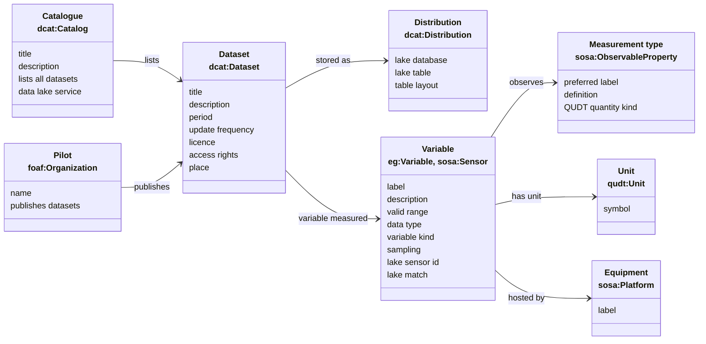
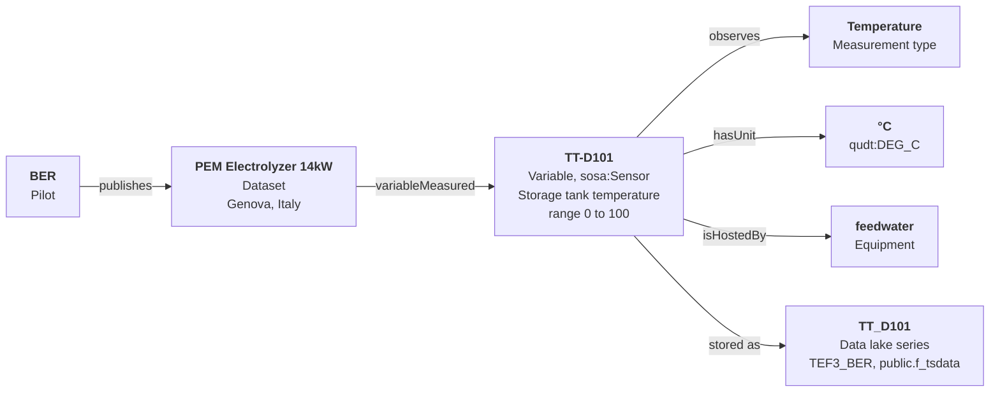
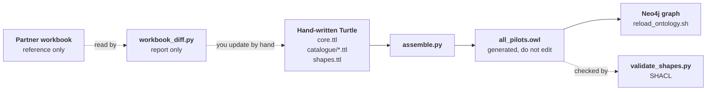

# EnergyGuard Ontology: a plain-language guide

> **In one sentence:** the ontology is a map that says, for every EnergyGuard pilot,
> *which datasets exist, which columns (variables) they contain, what each column measures,
> and where in the data lake the actual numbers are.*

It does **not** contain the measurements themselves (no time-series values). It only describes them:
the **library catalogue**, not the books.

It is built on standards wherever one exists (DCAT, SOSA, QUDT, SKOS, PROV, DQV, GeoSPARQL, FOAF). Only about 19 terms
are EnergyGuard's own, for things no standard covers (such as where a variable sits in the data lake).

---

## Contents

1. [The big picture](#1-the-big-picture)
2. [Pilots, datasets and variables](#2-pilots-datasets-and-variables)
3. [What a variable measures: measurement types and units](#3-what-a-variable-measures-measurement-types-and-units)
4. [Equipment](#4-equipment)
5. [Where the data is: the data lake](#5-where-the-data-is-the-data-lake)
6. [Walk-through: one real sensor](#6-walk-through-one-real-sensor)
7. [Names, prefixes and addresses](#7-names-prefixes-and-addresses)
8. [Standards we reuse](#8-standards-we-reuse)
9. [What it looks like in Neo4j](#9-what-it-looks-like-in-neo4j)
10. [Where the file comes from (and how to update it)](#10-where-the-file-comes-from-and-how-to-update-it)
11. [Glossary](#11-glossary)
12. [Known gaps](#12-known-gaps)

---

## 1. The big picture



Three levels, read top to bottom:

| Level | What it is | Count |
|---|---|---|
| **Pilot** | A partner that delivers data (RDN, CIEMAT, BER, CEA, CARTIF, REA, ENGREEN) | 7 |
| **Dataset** | One data source of a pilot | 41 |
| **Variable** | One column or signal of a dataset | 946 |

Variables are tied to **measurement types** (a shared vocabulary: Temperature, Pressure, Power, …), to **units**
(QUDT), to the **equipment** that hosts them, and to **where they are stored** in the data lake.

---

## 2. Pilots, datasets and variables

**Catalogue.** All datasets are listed in one `dcat:Catalog`, `mp:EnergyGuardCatalogue` (`ontology/catalogue/catalogue.ttl`), which also points to the data lake service. It is the single entry point, and it is what DCAT-aware tools harvest.

**Pilot.** Each pilot is the `dct:publisher` of its datasets. In Neo4j the pilot gets a `HAS_DATASET` edge to each one.

**Dataset.** A `dcat:Dataset`, described with the standard DCAT/Dublin Core terms:

| What | Term |
|---|---|
| Title, description | `dct:title`, `dct:description` |
| Period covered | `dct:temporal` (a `dct:PeriodOfTime` with start and end) |
| Time resolution, update frequency | `dcat:temporalResolution`, `dct:accrualPeriodicity` |
| Licence, access conditions | `dct:license`, `dct:accessRights` |
| Place | `dct:spatial` |
| Where the data can be fetched | `dcat:distribution` (a `dcat:Distribution` with a `dcat:DataService`) |

The file format is `dct:format` and the marker for missing values is `csvw:null`. Only the time zone has no standard term (`eg:timeZone`). The system a dataset covers and where its data comes from are written in its description.

**Variable.** One column or signal of a dataset, linked with `schema:variableMeasured` (the schema.org term for a dataset's variables). It carries:

- `rdfs:label` (the name) and `dct:description`;
- the unit, as `qudt:hasUnit`; the valid range, as `schema:minValue` / `schema:maxValue` (typed numbers, `xsd:decimal`);
- `eg:variableKind` (measured, calculated, setpoint, state, alarm, output, static, modelled, timestamp, identifier),
  `eg:dataType`, `eg:aggregation`, `eg:sampling`, `eg:recordThreshold`, `eg:decimals` (an integer), `eg:signConvention`, `eg:codeList`.

The time stamp column has kind `timestamp` and address/cadastre/id columns have kind `identifier`.

---

## 3. What a variable measures: measurement types and units

**Measurement types** are a small SKOS vocabulary (the `EnergyGuard measurement types` scheme, namespace `prop:`).
Each type is a `skos:Concept` and a `sosa:ObservableProperty`, with a definition and, where QUDT has one, a
`qudt:hasQuantityKind`. They are shared by all pilots: that is what lets you ask for *every pressure sensor of every pilot*.

| Variable | How it is linked to its type |
|---|---|
| A physical sensor (`sosa:Sensor`) | `sosa:observes` → the type |
| A state, setpoint, command or calculated value (not a sensor) | `eg:relatesToProperty` → the type |

**Units** are QUDT units (`http://qudt.org/vocab/unit/DEG_C`, `…/KiloW`), each with a `qudt:symbol` so it prints as
`°C` or `kW`. A unit QUDT does not have is kept as text in `schema:unitText`.

---

## 4. Equipment

The physical equipment of a pilot (a tank, a dryer, a feedwater loop, the battery) is a `sosa:Platform`. A variable is
`sosa:isHostedBy` its platform. BER, CEA, CARTIF, CIEMAT and ENGREEN have equipment; RDN and REA do not.

---

## 5. Where the data is: the data lake

The values live in the EnergyGuard data lake (PostgreSQL, operated by CARTIF), one database per pilot, time series in a
long table (one row per reading) and some datasets in wide tables (one column per variable). The ontology records:

| On | What | Terms |
|---|---|---|
| The dataset's distribution | database, table, layout | `eg:storedInDatabase`, `eg:storedInDatabaseTable`, `eg:tableLayout` |
| The variable | the series it is in the table | `eg:dataLakeSensorId`, `eg:dataLakeSensorPattern`, `eg:storedInDatabaseColumn` |
| The variable | how sure the match is | `eg:dataLakeMatch`: exact, normalised, pattern, column, timestamp, inferred |
| The variable | for an `inferred` match: why it was made (to be confirmed by the pilot) | `eg:dataLakeEvidence` |

The saved query `02_find_a_variable` turns this into a ready-to-run SQL query for any variable.
The server address is not stored in the ontology.

---

## 6. Walk-through: one real sensor

BER's storage tank temperature, as written in `ontology/catalogue/ber.ttl`:

```turtle
ber:TT-D101 a sosa:Sensor, eg:Variable ;
    rdfs:label "TT-D101"@en ;
    dcterms:description "Storage tank temperature"@en ;
    qudt:hasUnit unit:DEG_C ;
    schema:minValue "0.0" ;  schema:maxValue "100" ;
    sosa:observes prop:Temperature ;
    sosa:isHostedBy ber:Platform_feedwater ;
    eg:dataLakeSensorId "TT_D101" ;  eg:dataLakeMatch "normalised" ;
    eg:dataType "float" ;  eg:variableKind "measured" ;
    eg:aggregation "instantaneous" ;  eg:sampling "Over threshold (0.1s) or 30s" .
```



Read it as: *TT-D101 is a temperature sensor of the feedwater equipment, in °C between 0 and 100, sampled when it
changes by 0.05 or every 30 s, and it is the series `TT_D101` in the BER lake table.*

To see it in Neo4j, run `scripts/cypher/00_one_example_path.cypher`.

---

## 7. Names, prefixes and addresses

| Prefix | Namespace |
|---|---|
| `eg:` | `https://www.energyguard.eu/ontology#` (the core terms) |
| `prop:` | `https://www.energyguard.eu/ontology/property#` (measurement types) |
| `mp:` | `https://www.energyguard.eu/ontology/merged-pilots#` (the pilots) |
| `ber:`, `cea:`, `cartif:`, `ciemat:`, `rea:`, `engreen:`, `rdn:` | `https://www.energyguard.eu/ontology/<pilot>#` (that pilot's datasets, variables, equipment) |

Items are named `<pilot namespace>#<name>`: `ber#TT-D101`, `cea#Dataset_CEA_MURPHY_test_bed_dataset`.
The ontology itself is `https://www.energyguard.eu/ontology/merged-pilots`, version 2.0.0.

---

## 8. Standards we reuse

| Standard | Used for | Example |
|---|---|---|
| **DCAT** | The catalogue, datasets, distributions, data services | every dataset is a `dcat:Dataset` |
| **Dublin Core Terms** | Title, description, publisher, period, licence, access rights, place, file format | `dct:publisher mp:CEA` |
| **SOSA** | Sensors, measurement types, equipment | `sosa:observes prop:Temperature`, `sosa:isHostedBy ber:Platform_dryer` |
| **QUDT** | Units and quantity kinds | `qudt:hasUnit unit:DEG_C`, `qudt:symbol "°C"` |
| **SKOS** | The measurement-type vocabulary | `skos:prefLabel "Temperature"`, `skos:inScheme eg:MeasurementTypeScheme` |
| **PROV** | Who wrote a description and where it came from | `prov:wasAssociatedWith` on datasets |
| **DQV** | Quality notes (e.g. a valid range contradicted by the readings) | `dqv:hasQualityMeasurement` |
| **GeoSPARQL** | Spatial datasets (geometry collections) | `geosparql:FeatureCollection` |
| **FOAF** | Pilots and partner organisations | `foaf:Organization` |
| **schema.org** | A dataset's variables, minimum and maximum value, unit as text | `schema:variableMeasured`, `schema:minValue`, `schema:unitText` |
| **CSVW** | Column name and format in the source file, missing-value marker | `csvw:name`, `csvw:format`, `csvw:null` |
| **SHACL** | The checks in `ontology/shapes.ttl` | see section 10 |

The original per-pilot vocabularies (measurement classes, sensor groups) were removed: what they said is now carried
by the measurement types, units and equipment above. They are kept in `archive/pilot_ontologies/`.

---

## 9. What it looks like in Neo4j

After import and mapping (`utils/cypher/01` and `02`), the graph has a small, friendly shape:

```
(Pilot)-[:HAS_DATASET]->(Dataset)-[:HAS_VARIABLE]->(Variable)
(Variable)-[:OF_TYPE]->(MeasurementType)
(Variable)-[:HAS_UNIT]->(Unit)
(Variable)-[:HOSTED_BY]->(Platform)
```

Every node also has a readable `displayName`, and variables get shortcuts such as `lakeSensorId` and `measurementType`, datasets get `database` and `dbTable`,
so a query rarely needs the long RDF names.

### Saved queries (`scripts/cypher/`)

| File | Shows |
|---|---|
| `00_one_example_path` | **Start here**: one sensor and everything it connects to |
| `01_where_is_the_data` | Each dataset's lake database/table and coverage |
| `02_find_a_variable` | Search a variable and get a ready-to-run SQL query |
| `03_not_in_the_lake` | Variables described but not found in the lake |

For Python without Cypher, use the explore kit (`scripts/explore/`): `eg.pilots()`, `eg.find("storage tank")`, `eg.describe("TT-D101")`.

---

## 10. Where the file comes from (and how to update it)



```
ontology/core.ttl              the 19 EnergyGuard terms         (hand-written)
ontology/catalogue/*.ttl       pilots, datasets, variables       (hand-curated: one file per pilot, shared.ttl, catalogue.ttl)
ontology/shapes.ttl            SHACL checks
        │  python3 utils/ontology/assemble.py
        ▼
ontology/all_pilots.owl        the one file Neo4j imports (generated, do not edit)
```

- **The Turtle files are the source of truth.** Nothing reads the partners' Excel workbooks automatically.
- **When a partner sends a new workbook:** run `python3 utils/ontology/workbook_diff.py <pilot>`. It lists what the
  workbook would change (new datasets or variables, different descriptions or units, variables the workbook no longer
  has). Nothing is applied: you decide, then edit the Turtle file by hand.
- **After any edit:** `assemble.py`, then `validate_shapes.py` (0 violations expected; warnings flag missing
  descriptions and ranges in another unit), then `utils/neo4j/reload_ontology.sh`.
- **The data lake links** (`eg:dataLake…`) are edited by hand in the catalogue. `archive/lake_discovery/discover_data_lake.py` is the old read-only checker, kept in case the lake changes.
- The assembly is deterministic: unchanged inputs give a byte-identical file.

---

## 11. Glossary

| Term | Plain meaning |
|---|---|
| **Ontology** | A shared dictionary + map: which kinds of things exist and how they relate |
| **RDF / OWL / Turtle** | The standards and file format the ontology is written in (Turtle is the readable one) |
| **IRI** | A unique web-style ID for each item (like a URL) |
| **Prefix** | A short alias for the start of an IRI (`ber:` = `https://…/ontology/ber#`) |
| **Dataset** | One data source delivered by a pilot (`dcat:Dataset`) |
| **Variable** | One column/signal of a dataset |
| **Measurement type** | What a variable measures (Temperature, Power, …), shared by all pilots |
| **Platform** | A piece of equipment that hosts sensors (`sosa:Platform`) |
| **SHACL** | A language for checking that the data follows the model |
| **n10s** | The Neo4j plugin that imports RDF |
| **QUDT** | A standard catalogue of units and quantity kinds |

---

## 12. Known gaps

- **RDN** has no metadata workbook yet: its datasets are listed by name only.
- **Not everything is in the lake:** some datasets (mostly REA, and ENGREEN files not ingested) have no location.
  `01_where_is_the_data` and `03_not_in_the_lake` show the current numbers.
- **Some lake matches are `inferred`, not confirmed** (CIEMAT, CEA): the reason is in each variable's `eg:dataLakeEvidence` and
  they need the partner's confirmation.
- **Some valid ranges are contradicted by the readings** and some descriptions are missing; the SHACL report lists them
  as warnings.
- **BER** has two datasets (7 kW and 14 kW) that share 185 variables.
