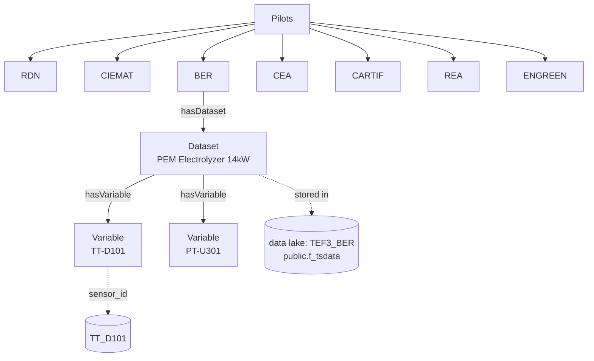
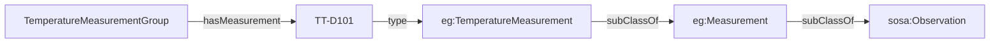
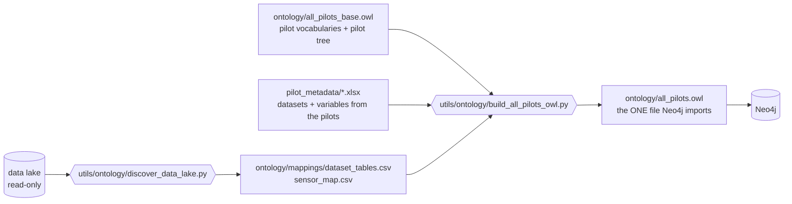

# EnergyGuard Ontology: a plain-language guide

> **In one sentence:** the ontology is a map that says, for every EnergyGuard pilot,
> *which datasets exist, which columns (variables) they contain, what each column means,
> and where in the data lake the actual numbers are.*

It does **not** contain the measurements themselves (no time series values). It only describes them.
Think of it as the **library catalogue**, not the books.

---

## Contents

1. [The big picture](#1-the-big-picture)
2. [Level 1: Pilots](#2-level-1-pilots)
3. [Level 2: Datasets](#3-level-2-datasets)
4. [Level 3: Variables](#4-level-3-variables)
5. [Inside a pilot: its own vocabulary](#5-inside-a-pilot-its-own-vocabulary)
6. [Walk-through: one real sensor](#6-walk-through-one-real-sensor)
7. [Names, prefixes and addresses](#7-names-prefixes-and-addresses)
8. [Standards we reuse](#8-standards-we-reuse)
9. [What it looks like in Neo4j](#9-what-it-looks-like-in-neo4j)
10. [Where the file comes from (and how to update it)](#10-where-the-file-comes-from-and-how-to-update-it)
11. [Glossary](#11-glossary)
12. [Known gaps](#12-known-gaps)

---

## 1. The big picture

Everything hangs off one tree with three levels:



| Level | What it is | Everyday analogy | How many |
|---|---|---|---|
| **Pilot** | A pilot organisation (demonstration site / partner) | A shelf in the library | 7 |
| **Dataset** | One data source delivered by a pilot | A book on the shelf | 41 |
| **Variable** | One column / signal / field in that dataset | A chapter in the book | 946 |

That's the core structure. Everything else in the file adds detail to these three levels.

---

## 2. Level 1: Pilots

The pilots are the top of the tree. Each pilot is named after its **organisation**: there are no pilot numbers.
RDN is split into two **sub-pilots** because its vocabulary has two parts (faults and time series).

| Pilot | Sub-pilot(s) | Organisation / site | Kind of data |
|---|---|---|---|
| **RDN** | RDNFaults, RDNTimeSeries | RDN | Grid faults, substation time series |
| **CIEMAT** | (none) | CEDER-CIEMAT, Soria (ES) | Microgrid: PV, wind, batteries, loads |
| **BER** | (none) | BluEnergy Revolution (IT/ES) | PEM electrolysers |
| **CEA** | (none) | CEA, Grenoble (FR) | High-temperature (SOC) electrolyser |
| **CARTIF** | (none) | CARTIF, Valladolid (ES) | Hydrogen test bench |
| **REA** | (none) | Riga Energy Agency (LV) | Buildings, heating, certificates, GIS |
| **ENGREEN** | (none) | ENGREEN / Antrodoco REC (IT) | Renewable energy community |

How they're connected:

```
Pilots ──hasPilot──▶ BER
Pilots ──hasPilot──▶ RDN ──hasSubPilot──▶ RDNFaults
```

---

## 3. Level 2: Datasets

A **dataset** is one data source, e.g. *"PEM Electrolyzer 14kW"* or *"Riga neighbourhoods"*.
Every dataset hangs under its pilot with a `hasDataset` link.

| Pilot | Datasets | Variables |
|---|---:|---:|
| RDN | 5 | 0 *(names only: no metadata file yet)* |
| CIEMAT | 1 | 37 |
| BER | 2 | 185 |
| CEA | 1 | 45 |
| CARTIF | 1 | 90 |
| REA | 25 | 536 |
| ENGREEN | 6 | 53 |

### What we know about each dataset

Each dataset carries the answers to the questions in the pilot metadata template:

| Question | Property | Example (CEA) |
|---|---|---|
| What is it called? | `dcterms:title` | CEA MURPHY test bed dataset |
| What does it show? | `dcterms:description` | Operating data of a high temperature electrolyzer system |
| Where? | `eg:location` | CEA, Grenoble, France |
| Which system? | `eg:systemDescribed` | Solid Oxide Cells eletrolyzer system *(as written by the pilot)* |
| Where does the data come from? | `eg:sourceSystem` | PLC |
| Which period? | `eg:temporalCoverage` | 08/09/2023-20/12/2023 |
| How often a value? | `eg:timeResolution` | 1m |
| Which time zone? | `eg:timeZone` | CET |
| How is it updated? | `eg:updateFrequency` | one shot export |
| File format? | `eg:fileFormat` | CSV |
| How are gaps marked? | `eg:missingValues` | *(not given by CEA: the field is simply absent)* |
| Terms of use? | `eg:licence` | *(not given by CEA)* |
| Who to ask? | `eg:dataOwnerContact` | CEA (organisation only: personal names and emails are not published) |
| **Which data-lake database?** | `eg:storedInDatabase` | `TEF4_CEA` |
| **Which table?** | `eg:storedInDatabaseTable` | `public.f_tsdata` |
| **Rows per reading or columns per variable?** | `eg:tableLayout` | `long` |

REA datasets also have `eg:sourceUrl` (open-data link), `eg:recordCount` and `eg:datasetType`
(time series / geospatial / tabular).

> **The data lake** (PostgreSQL, operated by CARTIF) has **one database per pilot**:
> `TEF1_RDN`, `TEF2_CEDER` (CIEMAT), `TEF3_BER`, `TEF4_CEA`, `TEF5_CARTIF`, `TEF6_REA`, `TEF7_ENGREEN`.
> Each stores its time series the same way, in a **long** table: one row per reading.
>
> ```
> public.f_tsdata (sensor_id, calendar_id, f_value, corrected)   ← one row per reading
> public.d_sensor (sensor_id, name, type_id, min_value, max_value, frequency)
> public.d_calendar (calendar_id → datetime)
> ```
>
> REA also has **wide** tables (one column per variable) in the `gis` and `cadastre` schemas,
> e.g. `gis.majas_energoefektivitates_raditaji`. Its `f_tsdata` holds two kinds of series: the monthly heat
> consumption of about 6,300 buildings (2024) and, since November 2024, **hourly air-quality readings** from
> Latvian monitoring stations (sensor ids like `Rīga-Kronvalda bulvāris_NO2`).
>
> 20 of the 41 datasets are located in the lake. The others (RDN, the ENGREEN price/GSE/mapping
> datasets, several REA datasets) are not there yet and have no location.
> The locations are in [`ontology/mappings/dataset_tables.csv`](../ontology/mappings/dataset_tables.csv).

---

## 4. Level 3: Variables

A **variable** is one column of a dataset: a sensor signal, a meter reading, a building attribute.
Every variable hangs under its dataset with a `hasVariable` link and has the type `eg:Variable`.

### What we know about each variable

| Question | Property | Example (BER `TT-D101`) |
|---|---|---|
| Name | `rdfs:label` | TT-D101 |
| What does it mean? | `dcterms:description` | Storage tank temperature |
| Unit (as written by the pilot) | `eg:unit` | °C |
| Unit (standard QUDT code) | `eg:hasUnit` | `unit:DEG_C` |
| Expected values | `eg:validRange` or `eg:minValue` / `eg:maxValue` | 0.0 to 100 |
| Data type | `eg:dataType` | float |
| Measured, calculated, setpoint, alarm…? | `eg:variableKind` | measured |
| Instantaneous, mean, sum…? | `eg:aggregation` | instantaneous |
| Which equipment? | `eg:subsystem` | feedwater |
| Sensor kind / ID | `eg:sensorType`, `eg:sensorId` | (when provided) |
| Meaning of codes | `eg:codeList` | e.g. `0 = Automatic; 1 = Service Mode` |
| Sign of flows | `eg:signConvention` | e.g. `+ = charging; - = discharging` |
| Column name in the pilot's file | `eg:sourceColumnName` | (when it differs from the name) |
| **Its sensor in the data lake** | `eg:dataLakeSensorId` | `TT_D101` |
| **…or a pattern over many devices** | `eg:dataLakeSensorPattern` | `%\_day\_cap` (ENGREEN) |
| **…or a column of a wide table** | `eg:storedInDatabaseColumn` | `enef_klase` (REA) |
| **How it was found** | `eg:dataLakeMatch` | `normalised` |

The **database and table** are not repeated on each variable: they live on the dataset.

`eg:dataLakeMatch` tells you how much to trust the location:

| Value | Meaning |
|---|---|
| `exact` | the lake `sensor_id` is exactly the name in the metadata |
| `normalised` | same name, different spelling (`AS-B103` → `AS_B103`, `HC-PMP-C501` → `PMP_C501_HC`, `temp_c` → `temp_c_1`) |
| `inferred` | decided by us **from the data itself** (e.g. 0 W at night = PV; −74…0 A = a stack current); to be confirmed by the partner. Listed in `ontology/mappings/sensor_map_overrides.csv` with the evidence |
| `manual` | confirmed by a person |
| `pattern` | the lake keeps one sensor per device or channel; the pattern (an SQL `LIKE`) selects all of them |
| `column` | a real column of a wide table (REA) |
| `timestamp` | the time column: `public.d_calendar.datetime` |
| `none` | not found in the lake under this name (see `ontology/mappings/sensor_map.csv` for suggestions) |

Not every pilot fills every field. A variable only has the properties its pilot delivered.

### Controlled values

Three fields use one fixed spelling, whatever the pilot wrote ("Float"/"float", "Measured"/"measured").
Where the data lake has the same concept, we use **the lake's own words**: the data types below are the PostgreSQL
ones (`float` is PostgreSQL's `double precision`; the lake's time column is a `timestamp`).

| Field | Allowed values |
|---|---|
| `eg:dataType` | `float`, `integer`, `boolean`, `text`, `date`, `timestamp`, `geometry` |
| `eg:variableKind` | `measured`, `calculated`, `setpoint`, `state`, `alarm`, `output`, `static`, `modelled`, … (lower case) |
| `eg:aggregation` | `instantaneous`, `mean`, `sum`, `cumulative`, `none` |

When the pilot's aggregation text says more (e.g. *"mean of the preceding hour"*), the original text is kept in
`eg:aggregationNote`.

**Units** also have one spelling each (`eg:unit`): `MWH`/`MWh` → `MWh`, `ºC`/`°C` → `°C`, `Bar`/`bar` → `bar`,
`m2`/`m²` → `m²`, `kWh/m² gadā`/`kWh/m² per year` → `kWh/m²/year`, and so on. The lake has no unit column, so the
QUDT / SI symbol decides. `mbarg` (gauge pressure) and `mBar` stay different on purpose.
Units with no QUDT equivalent (`kWh/m²/year`, `Wp`, `LEL`, normal litres `NL/min`, BER's `step` and `word`) keep
only the text unit.

Some pilots wrote **a data type or a format in the unit column** ("Float64", "Polygon", "DD.MM.YYYY",
"EPSG code (EPSG:3059)", "A / B / C"). Those are not units, so they don't go in `eg:unit`: the data type goes to
`eg:dataType` (when the pilot gave none) and the format to **`eg:valueFormat`** (e.g. `DD.MM.YYYY`, `one of A / B / C`).

> **Rule of thumb for finding data:** *dataset → database + table, variable → sensor_id.*
> For BER's TT-D101 the ontology says: database `TEF3_BER`, table `public.f_tsdata`, sensor `TT_D101`:
>
> ```sql
> SELECT c.datetime, f.f_value
> FROM public.f_tsdata f JOIN public.d_calendar c USING (calendar_id)
> WHERE f.sensor_id = 'TT_D101'
> ORDER BY f.calendar_id DESC LIMIT 10;
> ```

---

## 5. Shared and pilot-specific vocabulary

Besides the catalogue, the ontology has a **vocabulary**: the kinds of things that exist at the sites.
It came from the original per-pilot ontologies (kept in [`ontology/pilots/`](../ontology/pilots/)).

**Concepts that several pilots share live once, in `eg:`.** For example, BER, CEA and CARTIF all have
pressure sensors, so there is one `eg:PressureMeasurement` and all three pilots use it.
**Only concepts unique to one pilot stay in that pilot's namespace**, e.g. `rea:Building` or `engreen:REC`.

It has three ingredients:

| Ingredient | What it is | Example |
|---|---|---|
| **Classes** (types) | Kinds of things | shared: `eg:TemperatureMeasurement`, `eg:SystemComponent`; pilot-only: `rea:Building` |
| **Groups** | Bundles of related sensors | `ber:TemperatureMeasurementGroup` |
| **Relations** | How things connect | `eg:hasMeasurement` (group → sensor), `eg:representsComponent`, `eg:hasUnit` |



So a sensor such as `TT-D101` belongs to two worlds at once:

- **the catalogue world:** it is a `Variable` of the dataset *PEM Electrolyzer 14kW*, stored as sensor `TT_D101`;
- **the vocabulary world:** it is an `eg:TemperatureMeasurement`, part of BER's `TemperatureMeasurementGroup`.

It is **one node** with both roles, not two copies.

How many classes live where:

| Namespace | Classes |
|---|---:|
| `eg:` shared: `Measurement` and 18 measurement types (Temperature, Pressure, Flow, Power, Energy, Current, Voltage, Speed, SolarRadiation, Composition, Volume, Timer, Efficiency, StateOfCharge, State, ControlSignal, Hydrogen, CloudCover), plus SystemComponent, Sensor, Battery, Variable, TimeColumn, IdentifierColumn | 25 |
| RDN faults / time series | 3 / 2 |
| CIEMAT | 7 |
| BER / CEA / CARTIF | 2 / 7 / 10 |
| REA | 14 |
| ENGREEN | 11 |
| Pilot tree (Pilots, Pilot, SubPilot, the 7 organisations, RDN's 2 sub-pilots) | 12 |

### How a sensor gets its measurement class

Every **time-series** variable has a measurement class (its measurement type), so one label finds the same kind of signal in every
pilot (`:eg__PowerMeasurement` finds power at CIEMAT, BER, CARTIF and ENGREEN). The class is decided in this order:

1. **the pilot metadata**: the unit (°C → Temperature, bar → Pressure, kW → Power, kWh → Energy, A → Current, …),
   else the sensor type ("Anemometer" → Speed), else the variable kind (state/alarm → State, output → ControlSignal);
2. **only if the metadata says nothing**: the data lake's own sensor type;
3. **last**: a boolean data type → State (an on/off signal).

Columns of a time-series dataset that are not measurements get their own class instead: the time stamp column is an
`eg:TimeColumn`, and columns that identify the object measured (REA's address and cadastre number) are an
`eg:IdentifierColumn`. Both sit under `eg:Variable`, not under `eg:Measurement`.

When the two disagree, the metadata wins. Every decision and disagreement is listed in
`output/reports/variable_classes_report.csv`. (Most disagreements are BER sensors that the lake types as
"Status" whatever they measure.) Static attributes, like REA's addresses or construction years, get no
measurement class.

The namespace tells you which pilot a term belongs to (`cea:…` is CEA's); there is no separate
"belongs to pilot" link.

---

## 6. Walk-through: one real sensor

Let's follow **`TT-D101`** from the top of the tree down to the database.

```
Pilots
 └─ BER                                   (pilot)
     └─ Dataset "PEM Electrolyzer 14kW"    (dataset)
         │   location ........ Genova, Italy
         │   time zone ....... Europe/Rome
         │   data lake ....... TEF3_BER · public.f_tsdata (long)
         └─ TT-D101                        (variable)
                description ... Storage tank temperature
                unit .......... °C   (QUDT: DEG_C)
                range ......... 0.0 – 100
                kind .......... measured
                subsystem ..... feedwater
                sensor_id ..... TT_D101   (found by: normalised)
                type .......... eg:TemperatureMeasurement
                group ......... TemperatureMeasurementGroup
```

Reading it out loud: *"BER has a dataset from the 14 kW electrolyser in Genova.
One of its signals, TT-D101, is the storage-tank temperature in °C, normally between 0 and 100,
and you'll find its readings in database `TEF3_BER`, table `public.f_tsdata`, where `sensor_id = 'TT_D101'`."*

> BER has two electrolysers (14 kW and 7 kW) with the **same signal list**. Each BER variable therefore
> belongs to both datasets. In the lake both currently point to the same sensors in `TEF3_BER`.

---

## 7. Names, prefixes and addresses

Every item has a unique web-style address (an **IRI**). To keep them short we use **prefixes**:
`ber:TT-D101` is short for `https://www.energyguard.eu/ontology/ber#TT-D101`.

### EnergyGuard prefixes

| Prefix | Stands for | Contains |
|---|---|---|
| `eg:` | `https://www.energyguard.eu/ontology#` | Shared EnergyGuard terms (`Variable`, `hasVariable`, `Measurement`, `TemperatureMeasurement`, `hasUnit`, …) |
| `mp:` | `…/ontology/merged-pilots#` | The pilot tree (`Pilots`, `BER`, `CEA`, …, `hasDataset`) |
| `rdn:` / `rdnf:` / `rdnts:` | `…/ontology/rdn#`, `/rdn/faults#`, `/rdn/timeseries#` | RDN |
| `ciemat:` | `…/ontology/ciemat#` | CIEMAT |
| `ber:` | `…/ontology/ber#` | BER |
| `cea:` | `…/ontology/cea#` | CEA |
| `cartif:` | `…/ontology/cartif#` | CARTIF |
| `rea:` | `…/ontology/rea#` | REA (Riga) |
| `engreen:` | `…/ontology/engreen#` | ENGREEN |

**Shared or per pilot?** A concept used by several pilots is defined **once in `eg:`**
(`eg:Measurement`, `eg:PressureMeasurement`, `eg:hasUnit`). A pilot namespace only holds what is unique
to that pilot (its sensors, groups, datasets and special classes such as `rea:Building`), so the same
name never means two things.

### How the items are named

| Item | Naming pattern | Example |
|---|---|---|
| Dataset | `<pilot>:Dataset_<Title>` | `cea:Dataset_CEA_MURPHY_test_bed_dataset` |
| Sensor variable (time-series pilots) | `<pilot>:<TAG>` | `ber:TT-D101` |
| Column variable (REA, ENGREEN) | `<pilot>:<Dataset>__<column>` | `rea:Noise_levels__db` |

REA and ENGREEN columns include the dataset in their name because the same column name
(e.g. `address`, `geometry`) appears in many datasets with different meanings.

---

## 8. Standards we reuse

Instead of inventing everything, the ontology borrows well-known terms from public standards:

| Standard | Used for | Example term |
|---|---|---|
| **SOSA** (W3C) | Sensors and observations | `sosa:Observation`, `sosa:hasSimpleResult` |
| **SAREF** (ETSI) | Devices | `saref:Device` |
| **SAREF4ENER** (ETSI) | Energy devices and flows | `s4ener:PowerProfile` |
| **DCAT** (W3C) | Data catalogues | `dcat:Dataset` |
| **Dublin Core** | Titles, descriptions | `dcterms:title` |
| **QUDT** | Units of measurement | `unit:DEG_C`, `unit:KiloW` |
| **RDF Data Cube** | Statistical time series (RDN) | `qb:MeasureProperty` |
| **BOT** | Buildings, zones, spaces (REA) | `bot:Zone` |
| **FOAF** | People and organisations (ENGREEN) | `foaf:Organization` |
| **WGS84 Geo** | Coordinates | `geo:Point` |

---

## 9. What it looks like in Neo4j

When the file is imported with **n10s** (Neosemantics), the RDF is translated to a property graph:

| In the ontology | In Neo4j | Example |
|---|---|---|
| An item (IRI) | a **node** with label `Resource` and property `uri` | `uri: "…/ber#TT-D101"` |
| `rdf:type` | an extra **label** `prefix__Class` | `:eg__Variable`, `:eg__TemperatureMeasurement` |
| A link to another item | a **relationship** `prefix__name` | `-[:eg__hasVariable]->` |
| A text/number value | a **property** `prefix__name` | `eg__storedInDatabaseColumn` |

> Values are imported as **lists** (the import uses `handleMultival: 'ARRAY'`), so write
> `'TT-D101' IN v.eg__storedInDatabaseColumn` rather than `= 'TT-D101'`.
> The import script registers all prefixes first (EnergyGuard and standards), so names read `eg__…`, `ber__…`, `dcterms__…`.
> Types become **labels** (`:eg__TemperatureMeasurement`), not `rdf__type` relationships.
> The queries below match on the end of relationship names anyway, so they also work on older imports.

### Starter queries

**All datasets per pilot**
```cypher
MATCH (p:Resource)-[r]->(d:Resource)
WHERE type(r) ENDS WITH '__hasDataset'
RETURN p.rdfs__label AS pilot, d.rdfs__label AS dataset
ORDER BY pilot, dataset;
```

**The variables of one dataset, with their column and unit**
```cypher
MATCH (d:Resource)-[r]->(v:Resource)
WHERE type(r) ENDS WITH '__hasVariable'
  AND 'CEA MURPHY test bed dataset' IN d.rdfs__label
RETURN v.rdfs__label AS variable, v.eg__dataLakeSensorId AS sensor_id,
       v.eg__unit AS unit, v.dcterms__description AS description;
```

**Where is a sensor stored?** (database and table are on the dataset)
```cypher
MATCH (d:Resource)-[:eg__hasVariable]->(v:Resource)
WHERE 'TT-D101' IN v.rdfs__label
RETURN d.eg__storedInDatabase AS database, d.eg__storedInDatabaseTable AS table,
       v.eg__dataLakeSensorId AS sensor_id, v.dcterms__description AS meaning;
```

After running `02_map_all_pilots_all_in_one.cypher`, every measurement also carries the shortcuts
`database`, `dbTable`, `tableLayout`, `lakeSensorId`, `lakeSensorPattern`, `lakeColumn` and `lakeMatch`.

**All temperature sensors across all pilots** (one shared label)
```cypher
MATCH (d:Resource)-[:eg__hasVariable]->(v:eg__TemperatureMeasurement)
RETURN v.rdfs__label AS sensor, d.eg__storedInDatabase AS database, v.eg__dataLakeSensorId AS sensor_id;
```

---

## 10. Where the file comes from (and how to update it)

You don't edit the big OWL file by hand. It is **generated**:



| To change… | Edit… | Then |
|---|---|---|
| A dataset or variable description, unit, range | the pilot's workbook in `pilot_metadata/` | rebuild |
| Where data lives (after the lake changes) | re-run `utils/ontology/discover_data_lake.py` | rebuild |
| A wrong or missing lake match | add a row to `ontology/mappings/sensor_map_overrides.csv` (`match` = `inferred`, `manual` or `none`) | re-run discovery, rebuild |
| A pilot class or relation | `ontology/all_pilots_base.owl` | rebuild |

```bash
pip install rdflib openpyxl psycopg2-binary
python3 utils/ontology/discover_data_lake.py   # only when the lake changed
python3 utils/ontology/build_all_pilots_owl.py
```

The discovery script also writes `output/reports/lake_unmapped_sensors.csv`: sensors that are in the lake
but that no pilot metadata describes (worth asking the pilots about).

Then load it into Neo4j with `utils/neo4j/reload_ontology.sh` (backup, reset, import, mapping, validation),
and look at it with the scripts in `scripts/visualize/` or the Browser queries in `scripts/cypher/browser/`
(see [scripts/README.md](../scripts/README.md)).

**Ground rules the build follows**

- **The pilot metadata is the truth.** If a sensor's name, unit or range in the metadata differs from
  the old pilot ontology, the metadata wins.
- **No duplicates.** When a metadata variable matches an existing sensor (same tag), the information is
  added to that node instead of creating a second one.
- **Only what the metadata backs.** For CIEMAT, BER, CEA and CARTIF, old sample sensors and sample datasets that
  are not in the metadata are left out.
- **Say it once.** Shared concepts are defined once in `eg:`; a table is stated once, on its dataset;
  values use one spelling.
- **Same input, same output.** Rebuilding without changes gives a byte-identical file, so Git diffs only
  show real changes.

---

## 11. Glossary

| Term | Plain meaning |
|---|---|
| **Ontology** | A shared dictionary + map: which kinds of things exist and how they relate |
| **OWL / RDF** | The file format/standard the ontology is written in |
| **IRI** | A unique web-style ID for each item (like a URL) |
| **Prefix** | A short alias for the start of an IRI (`ber:` = `https://…/ontology/ber#`) |
| **Class** | A *type* of thing (e.g. *TemperatureMeasurement*) |
| **Individual** | A concrete thing of some type (e.g. sensor *TT-D101*) |
| **Property** | A link or attribute (e.g. *hasVariable*, *unit*) |
| **Dataset** | One data source delivered by a pilot |
| **Variable** | One column/signal of a dataset |
| **n10s** | The Neo4j plugin that imports RDF/OWL |
| **QUDT** | A standard list of units (`DEG_C`, `KiloW`, …) |

---

## 12. Known gaps

- **RDN** has no metadata workbook yet: its 5 datasets are listed by name only.
- **Not everything is in the lake yet:** 21 of 41 datasets have no location, and 471 variables are `none`
  (mostly REA datasets without a table and the ENGREEN files that are not ingested).
- **16 matches are `inferred`, not confirmed:** CIEMAT (12: PV vs consumption sensors, the batteries, TURBINA) and CEA
  (4: `I_stack0N_mes` = `Istack0N`). The evidence for each is in `ontology/mappings/sensor_map_overrides.csv`.
- **Lake sensors without metadata** are listed in `output/reports/lake_unmapped_sensors.csv`, each with a `hint`:
  49 of them (43 CEA, 3 CIEMAT, 2 CARTIF, 1 BER) were described by the original pilot ontologies but are missing
  from the pilot metadata; 628 ENGREEN ones are undescribed signals of devices whose other signals are mapped
  (`output/reports/lake_devices.csv` gives each device's kind); 38 are REA air-quality sensors whose pollutant is not
  in the metadata; CARTIF's `Fan_state` duplicates `Fan_State`. RDN's 57 sensors wait for its metadata.
- **CIEMAT valid ranges** are taken as delivered, but some look shifted between columns in the source workbook.
- **ENGREEN sample records** (one example user with a few measurements) from the original ontology are still
  included; their references to records the original never defined have been removed.
