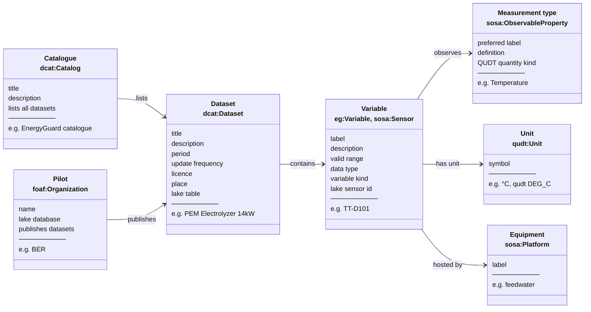
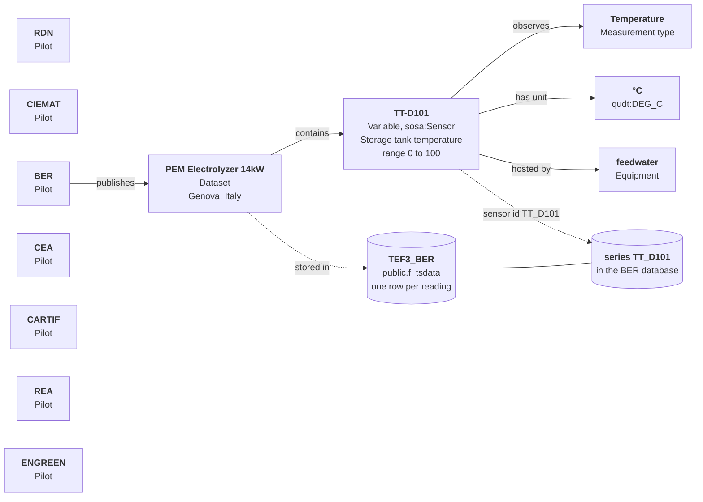
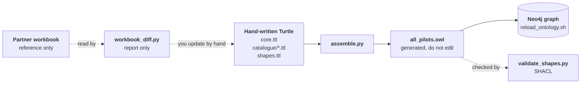

# EnergyGuard Ontology: a guide for newcomers

## What is this?

EnergyGuard brings together energy data from **seven partners** ("pilots"): a microgrid, electrolysers, a hydrogen test
bench, buildings in Riga, an energy community and more. Each partner delivers files with its own column names, units and
conventions. On its own, that makes simple questions hard: *What does each partner deliver? Which sensors measure
pressure? Where do I find the readings of this one sensor?*

The **EnergyGuard ontology** answers those questions. It is a **catalogue that describes every partner's data in one
common way**: which datasets exist, which columns ("variables") they contain, what each column measures and in which
unit, and where in the data lake the numbers are stored.

Think of a library catalogue: it tells you which books exist and which shelf they are on, but it is not the books.
**The ontology does not contain any measurements.** It only describes them.

**What you can ask it**

- What does the BER pilot deliver?
- Which sensors, in any pilot, measure pressure?
- What does the variable `TT-D101` mean, in which unit, and what range is valid?
- Where do I fetch its readings, and with which SQL query?
- Which described variables are *not* in the data lake yet?

It is built on **public standards** wherever one exists (DCAT for datasets, SOSA for sensors, QUDT for units, and a few
more, see [section 8](#8-reference)), so other tools and people can read it. Only 13 terms are EnergyGuard's own.

---

## Contents

1. [The picture](#1-the-picture)
2. [The building blocks](#2-the-building-blocks)
3. [Where the numbers live: the data lake](#3-where-the-numbers-live-the-data-lake)
4. [A worked example: one real sensor](#4-a-worked-example-one-real-sensor)
5. [Using it](#5-using-it)
6. [How it is built and kept up to date](#6-how-it-is-built-and-kept-up-to-date)
7. [Known limitations](#7-known-limitations)
8. [Reference](#8-reference)

---

## 1. The picture

Everything is organised in three levels: a **pilot** publishes **datasets**, and a dataset contains **variables**.
Each variable is further described by what it measures, its unit, and the equipment that hosts it.



Each box shows its name, the standard it comes from (for example `dcat:Dataset`), the main facts the ontology keeps,
and below the line a real example from the BER pilot.

| Level | What it is | How many |
|---|---|---:|
| **Pilot** | A partner that delivers data | 7 |
| **Dataset** | One data source of a pilot | 41 |
| **Variable** | One column or signal of a dataset | 946 |

---

## 2. The building blocks

Each block below says what it is, what it gives you, and what the ontology records about it. The terms in
`code font` are the standard property names, useful if you read the files or write queries.

### Pilot

**What it is.** A partner organisation that delivers data.
**What it gives you.** The grouping that keeps each partner's data apart: "what does BER deliver?".

| What is recorded | Term |
|---|---|
| The organisation's name | `rdfs:label` (type `foaf:Organization`) |
| Its datasets | the reverse of `dct:publisher` |
| The data lake database that holds its data | `eg:storedInDatabase` |

| Pilot | Organisation / site | Kind of data | Datasets | Variables | Lake database |
|---|---|---|---:|---:|---|
| **RDN** | RDN | Grid and substation data | 5 | 0 (names only so far) | TEF1_RDN |
| **CIEMAT** | CEDER-CIEMAT, Soria (ES) | Microgrid: PV, wind, batteries, loads | 1 | 37 | TEF2_CEDER |
| **BER** | BluEnergy Revolution (IT/ES) | PEM electrolysers | 2 | 185 | TEF3_BER |
| **CEA** | CEA, Grenoble (FR) | High-temperature (SOC) electrolyser | 1 | 45 | TEF4_CEA |
| **CARTIF** | CARTIF, Valladolid (ES) | Hydrogen test bench | 1 | 90 | TEF5_CARTIF |
| **REA** | Riga Energy Agency (LV) | Buildings, heating, certificates, GIS | 25 | 536 | TEF6_REA |
| **ENGREEN** | ENGREEN, Antrodoco REC (IT) | Renewable energy community | 6 | 53 | TEF7_ENGREEN |

### Dataset

**What it is.** One data source of a pilot, for example "PEM Electrolyzer 14kW" or "Riga neighborhoods".
**What it gives you.** What the data is, what period it covers, how often it is updated, under which terms, and the
way into its variables and into the data lake.

| What is recorded | Term |
|---|---|
| Title and description | `dct:title`, `dct:description` |
| Period covered | `dct:temporal` (a start and an end) |
| Time resolution, update frequency | `dcat:temporalResolution`, `dct:accrualPeriodicity` |
| Licence and access conditions | `dct:license`, `dct:accessRights` |
| Place | `dct:spatial` |
| File format | `dct:format` |
| Marker for missing values | `csvw:null` |
| Time zone | `eg:timeZone` |
| Its variables | `schema:variableMeasured` |
| Which lake table holds its numbers | `eg:storedInDatabaseTable` (see [section 3](#3-where-the-numbers-live-the-data-lake)) |

The system a dataset covers and where its data comes from are written into its description.

### Variable

**What it is.** One column or signal of a dataset: a sensor series, a meter reading, a building attribute. It is the
finest item in the catalogue, and where a column gets its meaning.
**What it gives you.** What a column is called and means, its unit and valid range, what it
measures, which equipment hosts it, and which series holds its numbers in the lake.

| What is recorded | Term |
|---|---|
| Name and meaning | `rdfs:label`, `dct:description` |
| Unit | `qudt:hasUnit` (or `schema:unitText` when QUDT has no match) |
| Valid range | `schema:minValue`, `schema:maxValue` (numbers) |
| What it measures | `sosa:observes` |
| Equipment that hosts it | `sosa:isHostedBy` |
| Kind | `eg:variableKind`: measured, calculated, setpoint, state, alarm, output, static, modelled, timestamp, identifier (a physical sensor is measured by definition and does not repeat it) |
| How it is recorded | `eg:dataType`, `eg:aggregation` (only when not instantaneous), `eg:decimals`, `eg:signConvention`, `eg:codeList` |
| Which series in the lake | `eg:dataLakeSensorId`, `eg:dataLakeSensorPattern` or `eg:storedInDatabaseColumn` |

A physical sensor also has the type `sosa:Sensor`.

### Measurement type

**What it is.** A name for what a variable measures: Temperature, Pressure, Power, Voltage and so on. It is one small
vocabulary shared by all pilots, so the same word means the same thing everywhere. There are 18 types, from State
(the most used) to CloudCover.
**What it gives you.** Comparison across pilots: *every pressure sensor of every pilot* is a single query.

| What is recorded | Term |
|---|---|
| Name and definition | `skos:prefLabel`, `skos:definition` |
| The vocabulary it belongs to | `skos:inScheme` (the "EnergyGuard measurement types" scheme, prefix `prop:`) |
| The matching standard quantity | `qudt:hasQuantityKind`, where QUDT has one |

A variable points to its type with `sosa:observes`, whether it is a physical sensor, a state, a setpoint, a command or a
calculated value.

### Unit

**What it is.** What a variable's values are expressed in.
**What it gives you.** Consistent units. They come from QUDT, the standard catalogue of units, so `°C` and `kW` mean the
same in every pilot and can be compared or converted.

| What is recorded | Term |
|---|---|
| The unit itself | a QUDT unit such as `http://qudt.org/vocab/unit/DEG_C` |
| How it prints | `qudt:symbol` (`°C`, `kW`) |

### Equipment

**What it is.** A physical part of a pilot's installation that hosts sensors: a tank, a dryer, a feedwater loop, a battery.
**What it gives you.** Grouping by equipment: *which signals belong to the dryer?*

| What is recorded | Term |
|---|---|
| Its name | `rdfs:label` (type `sosa:Platform`) |
| The variables it hosts | the reverse of `sosa:isHostedBy` |

BER, CEA, CARTIF, CIEMAT and ENGREEN describe 71 pieces of equipment in total; RDN and REA describe none.

### Catalogue

**What it is.** The single entry point: one record that lists every dataset of every pilot.
**What it gives you.** One place to browse all 41 datasets, in a standard shape (`dcat:Catalog`) that other
catalogue tools can read.

| What is recorded | Term |
|---|---|
| Title and description | `dct:title`, `dct:description` |
| Its datasets | `dcat:dataset` |

It is called `mp:EnergyGuardCatalogue` and is written in `ontology/catalogue/catalogue.ttl`. A check makes sure every
dataset is listed in it.

---

## 3. Where the numbers live: the data lake

The measurements are stored in the **EnergyGuard data lake**, a PostgreSQL service operated by CARTIF, with **one
database per pilot**. Most time series are kept in a **long** table, one row per reading. Some datasets (mostly REA's
buildings and maps) sit in **wide** tables, one column per variable.

The ontology links the catalogue to the lake at three levels:

- A **pilot** names its database (`eg:storedInDatabase`), for example TEF3_BER for BER.
- A **dataset** names the table that holds its data (`eg:storedInDatabaseTable`). 20 of the 41 datasets are located in
  the lake; the others have no table yet. The table tells you the layout: `public.f_tsdata` is the long time-series
  table, anything else is a wide table.
- A **variable** names its series: a sensor id (`eg:dataLakeSensorId`), a pattern that selects one sensor per device
  (`eg:dataLakeSensorPattern`), or a column of a wide table (`eg:storedInDatabaseColumn`). A variable with none of
  these is not in the lake.

With this, the saved query `02_find_a_variable` produces a ready-to-run SQL query for any variable. The server address
is not stored in the ontology.

---

## 4. A worked example: one real sensor

Take `TT-D101`, a storage tank temperature in the BER pilot. Here is everything the ontology says about it, in plain
words and then in the file format:

> *TT-D101 is a temperature sensor of the feedwater equipment. Its values are in °C, between 0 and 100. It belongs to the dataset "PEM Electrolyzer 14kW" of the
> BER pilot, and its readings are the series `TT_D101` in the BER database.*



Solid arrows are the catalogue's own links. Dotted arrows lead to the data lake (the cylinders are databases): the
dataset points to its table, and the variable points to its series inside it. The other pilots, drawn on the left, have
the same structure.

As written in `ontology/catalogue/ber.ttl` (Turtle, the readable RDF format):

```turtle
ber:TT-D101 a sosa:Sensor, eg:Variable ;              # a sensor, and a variable of a dataset
    rdfs:label "TT-D101"@en ;                          # its name
    dcterms:description "Storage tank temperature"@en ;
    qudt:hasUnit unit:DEG_C ;                          # unit
    schema:minValue 0.0 ;  schema:maxValue 100 ;       # valid range
    sosa:observes prop:Temperature ;                   # what it measures
    sosa:isHostedBy ber:Platform_feedwater ;           # the equipment
    eg:dataLakeSensorId "TT_D101" ;                    # its series in the data lake
    eg:dataType "float" .
```

---

## 5. Using it

The catalogue is stored as a file (`ontology/all_pilots.owl`) and loaded into a **Neo4j graph database**, where you can
click through it or query it. A read-only copy is public at `https://ontology.energy-guard.eu` for everyone (user `neo4j`
and a shared password, from the project team): nobody can change it, and the Neo4j Browser is at
`https://ontology.energy-guard.eu/browser/`. There are three ways in, from easiest to most technical.

**1. From Python, no query language needed.** The folder `scripts/explore/` is a small standalone kit with a notebook.
You only need the shared password; it works from anywhere, with no extra software.

```python
import eg
eg.pilots()                    # which pilots exist and how big they are
eg.find("storage tank")        # search variables by words
eg.describe("TT-D101")         # print everything known about one variable
eg.readings_sql("TT-D101")     # the SQL that fetches its readings from the data lake
```

**2. In the Neo4j Browser (pictures).** Paste a query from `scripts/cypher/` and edit the first line. Graph queries draw
the connections; table queries list facts. Start with these, and see `scripts/README.md` for all 13:

| File | Shows |
|---|---|
| `00_one_example_path` | **Start here**: one sensor and everything it connects to |
| `10_hierarchy_overview` | Pilots → datasets → example variables → type and unit (the whole picture) |
| `02_find_a_variable` | Search a variable and get a ready-to-run SQL query for its data |
| `03_not_in_the_lake` | Variables described but not found in the lake |

**3. As plain files.** `ontology/` holds the source files in Turtle. They are readable, and any RDF tool can load
`all_pilots.owl`.

In Neo4j the graph has a small, friendly shape, with readable names and shortcuts so a query rarely needs the long RDF
names:

```
(Pilot)-[:HAS_DATASET]->(Dataset)-[:HAS_VARIABLE]->(Variable)
(Variable)-[:OF_TYPE]->(MeasurementType)
(Variable)-[:HAS_UNIT]->(Unit)
(Variable)-[:HOSTED_BY]->(Platform)
```

---

## 6. How it is built and kept up to date



- **The Turtle files are the source of truth.** `ontology/core.ttl` holds the 13 EnergyGuard terms, `ontology/catalogue/`
  holds one file per pilot plus the shared parts and the catalogue, and `ontology/shapes.ttl` holds the quality checks.
  Nothing reads the partners' Excel workbooks automatically.
- **When a partner sends a new workbook,** run `python3 utils/ontology/workbook_diff.py <pilot>`. It lists what the
  workbook would change (new datasets or variables, different descriptions or units, variables the workbook no longer
  has). Nothing is applied: you decide, then edit the Turtle file by hand.
- **After any edit,** run `python3 utils/ontology/assemble.py` (builds `all_pilots.owl`), then
  `python3 utils/ontology/validate_shapes.py` (0 violations expected; warnings flag missing descriptions and ranges in
  another unit), then `utils/neo4j/reload_ontology.sh` (empties and reloads the graph).
- **The data lake links** (`eg:dataLake…`) are edited by hand. `archive/lake_discovery/discover_data_lake.py` is the old
  read-only checker, kept in case the lake changes.
- The build is deterministic: unchanged inputs give a byte-identical file. A history of changes is in `CHANGELOG.md`.

---

## 7. Known limitations

- **RDN** has no metadata file yet, so its five datasets are listed by name only, with no variables.
- **Not everything is in the lake:** some datasets (mostly REA, and ENGREEN files not ingested) have no location.
  Queries `01` and `03` show the current numbers.
- **Some lake matches are guesses,** made from the readings and not yet confirmed by the partner (CIEMAT and CEA).
- **Some variables have no description,** and 8 CIEMAT valid ranges were left out because they were written in another
  unit than the variable (the columns look shifted in CIEMAT's workbook).
- **Not every variable has a measurement type.** Attribute-like columns (codes, dates, descriptive text, building
  attributes) measure nothing, so they have none.
- **BER** has two datasets (7 kW and 14 kW) that share 185 variables.

---

## 8. Reference

### Standards we reuse

| Standard | Used for | Example |
|---|---|---|
| **DCAT** | The catalogue and its datasets | every dataset is a `dcat:Dataset` |
| **Dublin Core Terms** | Title, description, publisher, period, licence, access rights, place, file format | `dct:publisher mp:CEA` |
| **SOSA** | Sensors, measurement types, equipment | `sosa:observes prop:Temperature`, `sosa:isHostedBy ber:Platform_dryer` |
| **QUDT** | Units and quantity kinds | `qudt:hasUnit unit:DEG_C`, `qudt:symbol "°C"` |
| **SKOS** | The measurement-type vocabulary | `skos:prefLabel "Temperature"`, `skos:inScheme eg:MeasurementTypeScheme` |
| **GeoSPARQL** | Spatial datasets (geometry collections) | `geosparql:FeatureCollection` |
| **FOAF** | Pilots and partner organisations | `foaf:Organization` |
| **schema.org** | A dataset's variables, minimum and maximum value, unit as text | `schema:variableMeasured`, `schema:minValue`, `schema:unitText` |
| **CSVW** | Column name and format in the source file, missing-value marker | `csvw:name`, `csvw:format`, `csvw:null` |
| **SHACL** | The quality checks in `ontology/shapes.ttl` | see [section 6](#6-how-it-is-built-and-kept-up-to-date) |

The pilots' own original vocabularies (measurement classes, sensor groups) were removed: what they said is now carried
by the measurement types, units and equipment. They are still in the git history.

### Names and prefixes

Every item has a unique web-style address (an IRI). A short prefix stands for the start of it.

| Prefix | Namespace |
|---|---|
| `eg:` | `https://ontology.energy-guard.eu/core#` (the 13 core terms) |
| `prop:` | `https://ontology.energy-guard.eu/property#` (measurement types) |
| `mp:` | `https://ontology.energy-guard.eu/pilots#` (the pilots and the catalogue) |
| `unit:` | `http://qudt.org/vocab/unit/` (QUDT units, such as `unit:DEG_C`) |
| `ber:`, `cea:`, `cartif:`, `ciemat:`, `rea:`, `engreen:`, `rdn:` | `https://ontology.energy-guard.eu/<pilot>#` (that pilot's datasets, variables, equipment) |

Items are named `<pilot namespace>#<name>`, for example `ber#TT-D101`. The addresses are names, not web pages: the domain serves the Neo4j Browser, not the ontology files, which are in the repository (`ontology/`). The ontology itself is
`https://ontology.energy-guard.eu/core`, version 2.1.0.

### Glossary

| Term | Plain meaning |
|---|---|
| **Ontology** | A shared dictionary and map: which kinds of things exist and how they relate |
| **RDF / OWL / Turtle** | The standards and file formats the ontology is written in (Turtle is the readable one) |
| **IRI** | A unique web-style ID for an item, like a URL |
| **Prefix** | A short alias for the start of an IRI (`ber:` = `https://…/ontology/ber#`) |
| **Pilot** | A partner organisation that delivers data |
| **Dataset** | One data source delivered by a pilot (`dcat:Dataset`) |
| **Variable** | One column or signal of a dataset |
| **Measurement type** | What a variable measures (Temperature, Power, …), shared by all pilots |
| **Equipment / Platform** | A piece of equipment that hosts sensors (`sosa:Platform`) |
| **Catalogue** | The one record that lists all datasets (`dcat:Catalog`) |
| **Data lake** | The PostgreSQL service where the actual measurements are stored |
| **SHACL** | A language for checking that the data follows the model |
| **n10s** | The Neo4j plugin that imports RDF |
| **QUDT** | A standard catalogue of units and quantity kinds |
